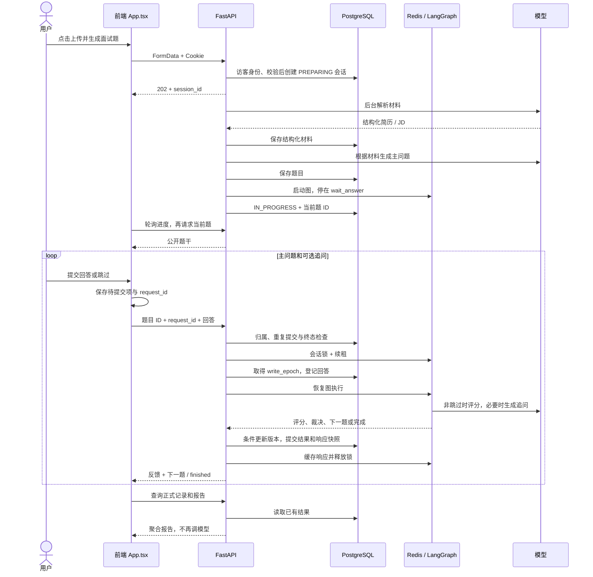

# 从“点击上传”到“面试结束”：项目主链路

这份说明按用户真正操作的顺序讲代码，适合一边打开文件、一边从按钮追到数据库。前端调用已经对照本机 `J:/develope/ai面试-前端/src/App.tsx` 和 `src/api.ts` 核实；本次注释修改位于当前后端项目。

建议先读一遍整条路线，再跟着文中的方法名跳转。每个后端函数和方法的第一段说明都写在代码旁边；不依赖容易过时的行号。

## 一眼看完：完整路线

图中的每一步可能失败；下面同时解释正常路径、失败后的去向和现有保护边界。

## 先记住四个角色

| 角色 | 存什么 | 解决什么问题 |
|---|---|---|
| FastAPI | HTTP 请求、Cookie、文件 | 接收前端动作，返回统一错误 |
| PostgreSQL | 会话、题目、回答、评分、材料 | 正式事实，恢复时以它为准 |
| Redis | 会话锁、幂等缓存、LangGraph checkpoint | 防并发，保存图停在哪一道题 |
| 模型 | 解析、出题、评分、追问 | 只负责智能判断，不直接决定数据库状态 |

## 一、前端点击“上传简历”之后

先看前端 `App.tsx`：实际页面先通过 `getMe()` 确认登录，未登录展示登录页。后端接口本身仍支持匿名访问，两者要区分。

| 前端方法或位置 | 实际做的操作 | 保护和目的 |
|---|---|---|
| `pickResume(file)` | 用户选文件时把 File 保存到组件状态 | 先检查前端文件大小；这是用户体验检查，后端仍要重新校验 |
| `pickJdFile(file)` | 保存可选 JD 文件，同时清掉 JD 文本 | 保证文件和文本二选一 |
| `startInterview()` | 检查已选简历、没有正在上传、JD 文本长度合法 | 按钮禁用加状态判断，减少重复点击 |
| `new FormData()` | 加入 `resume`、可选 `jd`/`jd_text` 和 `question_count` | 上传的是文件本身；浏览器生成 multipart 边界 |
| `api.ts:createInterview(form)` | 发起 `POST /api/interviews` | 统一走 `request()` |
| `api.ts:request()` | 调用 `fetch`，设置 `credentials: 'include'` | 允许浏览器携带 Cookie；Cookie 是否实际发送还受浏览器 SameSite、Secure 等规则约束 |
| `vite.config.ts` | 将 `/api` 代理到 `127.0.0.1:8000` | 开发时前端走同源地址，不必把后端地址硬编码在每个按钮里 |

请求到达 `app/main.py`：中间件、路由和错误处理器已经装配好，最终进入 `app/api/interviews.py:create_interview`。FastAPI 在调用路由函数前解析表单并执行依赖；不要把下列列表理解成每个依赖的严格执行顺序。

1. `get_visitor` 读取匿名 Cookie。Cookie 无效就创建新访客，数据库只保存 token 的 SHA-256，不保存明文。
2. `get_current_user` 验证登录 Cookie 的 HMAC 签名和过期时间，读取账号；`require_same_origin` 对带 `Origin` 的写请求核对允许的主机和端口。当前没有 `Origin` 的请求会放行。
3. `_validate_question_count` 限制题数，避免一次请求制造过多模型费用。
4. `_read_upload` 分块读取框架已经解析好的上传文件，累计超限停止。它限制业务代码读入的字节数，不能替代网关或 ASGI 层的总请求体限制，因为 multipart 已在进入路由前解析。
5. `_quick_validate → validate_upload` 检查扩展名、文件头和格式约束：PDF 检查能否打开、密码和页数；图片检查完整性和尺寸；DOCX 当前只检查 ZIP 和正文条目存在，尚未做整个压缩包的解压限制。
6. `sessions_repo.create` 在 PostgreSQL 建立一条 `PREPARING` 会话。此时还没有题目，只有会话 ID 和归属信息。
7. `_set_stage("QUEUED")` 写入前端可展示的准备阶段。
8. `BackgroundTasks` 启动 `_run_preparation`，接口立即返回 `202 + session_id`，前端随后轮询准备进度。

`202` 表示“已经受理”，不表示“解析出题成功”。前端收到后把 `session_id` 放进 `localStorage`，清掉旧待提交项，界面切到 `preparing`。

匿名 Cookie 在 `get_visitor` 中先登记到 `request.state.pending_set_cookie`；`main.py:PendingCookieMiddleware` 在最终响应出口补上它。这让由业务异常处理器生成的响应也能携带新访客身份，减少下一次请求认不出用户的情况。

这里的边界是：准备任务目前是进程内后台任务，服务重启可能中断它；轮询发现疑似孤儿后会标记 `PREPARATION_FAILED`。登记表和启动时间都只属于单个进程，多 worker 时可能误判。

## 二、后台解析简历和出题

入口是 `_run_preparation`，它自己重新打开数据库会话，因为原 HTTP 请求已经结束。

1. `build_parsed_input` 调用 `parsers/pipeline.py`，按文件类型选择 PDF、DOCX 或图片解析器。
2. `document.extract_pdf` 逐页读取文字；扫描页渲染成图片。 `extract_docx` 按原文顺序读取段落和表格，并提取内嵌图片。
3. `parse_materials` 调视觉模型，把简历/JD 转换成结构化材料。解析结果会经过 Pydantic 校验和必要的修复。
4. `materials_repo.save_parsed` 把材料保存到 PostgreSQL。解析成功后，即使出题失败，也可以复用材料重试，不必重复支付解析费用。
5. `generate_questions` 调文字模型生成题目；题数、编号、类别和评分要点再次校验。
6. `start_interview` 把主问题写入 `interview_questions`，再启动 LangGraph，让图停在第一道题的 `interrupt`。
7. 会话状态更新为 `IN_PROGRESS`，`current_question_id` 指向第一题，前端可以开始答题。

材料变成题目的具体保护如下：

| 位置 | 检查内容 | 失败后的处理 |
|---|---|---|
| `parsers/pipeline.py` | 材料至少有文字或图片，文字总量受限 | 无可读材料则停止，过长文字截断并记录警告 |
| `parse_agent._validate_with_repair` | 输出是符合结构的材料 JSON | 默认允许一次结构修复，仍失败就报错 |
| `parse_agent._semantic_check` | 至少有教育、经历或项目可用于提问 | 标记材料不足，不硬编经历 |
| `parse_agent._sanitize_evidence_refs` | 引用的证据 ID 确实存在 | 删除无效引用并添加警告 |
| `question_agent._validate` / `QuestionSet` | 题数一致、编号连续、题干不重复、权重合理、引用存在 | 有限次模型修复，仍失败则准备失败 |
| `questions_repo.public_dict` | 只返回公开题目字段 | 内部 `evaluation_rubric` 不发送给前端 |

结构校验能阻止不合格式的输出，但不能证明模型提取的每句话都真实，也不能完全消除提示词注入。模型通过适配器只返回文本，不直接操作数据库。

注意两个“准备”的区别：`_run_preparation` 是真正的解析和出题流程；图节点 `prepare` 只检查已有题目，不再解析简历、不再生成题目。

## 三、前端显示当前题

前端 `preparing` 对应的 `useEffect → tick()` 循环调用 `getProgress → GET /api/interviews/{id}`。一轮没回来就不发下一轮；网络错误有上限地延后重试；切换页面阶段时清定时器。

准备完成后才通过 `loadQuestion → getCurrentQuestion → GET /api/interviews/{id}/current-question` 取当前题；这两个接口分工不同，不是在同一轮里无限查询两个地址。

- `_owned_session → sessions_repo.get_owned` 把会话 ID 和身份放进 SQL：已登录只认账号；匿名只认当前访客且会话未绑定账号。这样同浏览器切换账号也不能沿用访客 Cookie 读取上一账号的面试。
- `graph_runtime.snapshot` 一次性读取图状态、下一节点和 interrupt，避免读到互相矛盾的快照。
- 如果 Redis checkpoint 存在，直接返回当前题。
- 如果 checkpoint 丢失，`recover_session` 从 PostgreSQL 的题目和正式回答重建图，再核对“当前题、已完成评分数、追问次数”三件事。

## 四、前端点击“提交回答”

前端 `sendAnswer()` 检查输入非空、当前题存在且没有正在提交，然后用 `newRequestId()` 创建本次操作的请求 ID，交给 `doSubmit()`。选择跳过则由 `skipQuestion()` 走同一个提交方法，发送 `submission_kind: 'skip'`。

`doSubmit()` 在发请求前先把 `{sessionId, questionId, requestId, answer, skip}` 放入内存和 `sessionStorage`。这份缓存包含回答原文，用途是刷新后续跑；成功后会清掉。

后端入口是 `api/interviews.py:submit_answer`，核心编排在 `services/interview_workflow.py:submit_answer`。

### 进入模型前的保护

1. 校验回答内容、题目 ID 和请求 ID。
2. `_owned_session` 做归属校验。
3. `idempotency.classify_submission` 根据已有记录分类，之后登记新回答时再检查一题只能提交一次：
   - 同一个 `request_id` 和同样内容且已完成：直接回放原响应；
   - 同一个 `request_id` 但内容变了：拒绝，防止一次请求被改头换面；
   - 同一题已经提交：拒绝，防止重复计分。
4. `locks.acquire` 从 Redis 获取“本会话锁”。Redis 不可用时直接返回 503，不无锁降级。
5. `sessions_repo.begin_write` 增加 `write_epoch`，取得本次写入资格。
6. `_register_new_answer` 用短事务登记 `PENDING` 回答。模型调用不放在事务里，避免长期占用数据库连接。

其中 `request_id` 是“一次提交的编号”，`question_id` 是“正在答哪题”，`session_id` 是“哪场面试”。三个编号不能互换。输入指纹目前会去掉空白，所以仅有空白变化的回答会被视为同一输入。

已完成结果的回放要排在终态检查前：最后一题已答完但响应丢失时，会话已经结束，仍应允许按原请求 ID 拿回评分。锁内还会重新读取状态和提交记录，减少并发期间的旧数据问题。

### 调模型和推进图

1. `graph_runtime.snapshot` 判断图当前在哪：等待回答、节点失败，还是已经跑完。
2. 等待回答时用 `resume_answer`，把回答交给 `wait_answer` 节点；节点失败时用 `continue_run`，只重跑失败节点。
3. `evaluate_answer_node` 调评分模型；`decide_followup_node` 用纯 Python 规则决定是否追问。
4. `build_followup_node` 需要追问时才调用模型。输出内容非法等生成失败会记录降级并跳过追问；`ModelCallError` 这类供应商/网络错误会上抛供重试，并非所有追问异常都直接跳过。
5. `advance_node` 移到下一道主问题，全部完成时把图标记为结束。

规则链在 `rules/followup_rules.py:decide_followup` 中：跳过、不适合追问、次数达到上限、分数和缺口条件、已问方向等都会影响结果。模型给的 `follow_up_suggested` 只是输入，最终路线由 Python 代码决定。

### 模型返回之后的保护

1. `_stage_result` 按题目在题序中的位置取评分，不能盲取列表最后一项。
2. `_save_stage_results` 保存评分、裁决和降级信息；评分要点只在数据库内部使用，不返回前端。
3. `sessions_repo.bump_state_version` 用 `state_version + write_epoch` 条件更新。锁过期、别人先推进或状态版本变化时，旧请求写不进去。
4. `_finalize` 将正式回答、下一题、会话状态和响应快照放在同一数据库事务中；将答案标记为 `COMPLETED` 后一起提交。
5. Redis 保存幂等响应，释放会话锁，把下一题返回前端。

前端 `doSubmit()` 收到成功响应，清空待提交缓存，显示评分反馈：`finished=true` 就进入结束页；否则展示 `next_question`。如果响应没有给下一题，就再加载一次当前题。

三个并发保护可以这样记：

| 机制 | 通俗理解 | 解决什么问题 |
|---|---|---|
| Redis 锁 | 同一时间只让一个操作办理这场面试 | 连点、两个页面、手动与后台重试互相撞车 |
| `write_epoch` | 每次接手发一个新的写入资格号 | 老执行者锁已失效，模型迟到结果不能再按旧资格写库 |
| `state_version` CAS | 提交前核对事实还是不是自己刚读的那一版 | 基于旧进度推进会话；条件更新失败则回滚 |

CAS 指“只有数据库仍是期望版本，才更新成新版本”。数据库唯一约束另行限制同会话请求 ID 和同题回答不得重复；这些措施侧重避免重复业务结果，不保证模型供应商只被调用一次。

## 五、网络失败、重复点击和后台补偿

- 前端重试必须复用原 `request_id`。这样后端能回放结果，不会重复评分。
- 模型超时或供应商不可用时，回答保留为可重试失败；`retry_worker.py` 按退避时间抢占任务，使用原回答和原请求 ID 续跑。
- `compensation.py` 把错误分成可重试、需恢复、冲突和致命四类；未知错误不自动重试，避免 bug 造成重复费用。
- Redis checkpoint 丢失时走 `/recover` 或自动恢复；恢复只从 PostgreSQL 正式记录重建，不重新猜分数。

前端遇到不同错误的去向：

| 错误/操作 | 前端方法 | 后续行为 |
|---|---|---|
| 网络失败、模型暂不可用 | `retrySubmit()` | 从待提交缓存取出原请求 ID 续跑 |
| `STATE_RECOVERY_REQUIRED` | `recoverAndContinue()` | 先调用 `/recover`，再用原提交续跑或加载当前题 |
| `STALE_QUESTION` / `REQUEST_CONFLICT` | `doSubmit()` 的错误分支 | 当前实现清掉待提交项并重新加载当前题，不无条件重投 |
| 准备失败且材料已保存 | `retryPrep()` | 调 `/retry-preparation`，回到轮询准备阶段 |
| 材料未保存 | `retryPrep()` | 提示重新上传，不能只重跑出题 |
| 页面刷新 | 初始化 `useEffect → resumePending()` | 从 localStorage 找会话，从 sessionStorage 找待提交项，再确认当前题后决定续跑 |

刷新时如果当前题已经变了，现有 `resumePending()` 会清理旧待提交项并显示新题；若服务端显示已经结束，则尝试用原请求 ID 取回最终结果。不要把文档中的“可以回放”误认为前端所有分支都自动展示上一题反馈。

`recover_session` 会保留已有评分，补齐裁决和快照，关闭中断提交，并删除待答题上确实没有评分和裁决的空壳记录。恢复不是重新开始一整场面试。

## 六、前端点击“结束面试”

前端 `endInterview() → api.ts:finishInterview() → POST /finish`，后端入口是 `finish_interview`。

1. 先做归属校验和状态检查。
2. 获取会话锁并取得写入栅栏。
3. 把会话更新为 `CANCELLED`，记录 `USER_ENDED`，清空当前题。
4. 用 `state_version` 条件提交，防止旧的答题请求把已经结束的会话重新推进。

成功后前端 `goFinished()` 切换结束页、清空当前题和待提交项，再调用 `loadRecords()` 获取记录与报告。

如果所有题自然答完，`_finalize` 会写 `FINISHED`；用户提前结束写 `CANCELLED`；准备失败写 `PREPARATION_FAILED`。代码还定义了 `EXPIRED`，但当前超时持久化有缺口，见后文。

## 七、结束后查看记录和报告

- `get_records` 只返回 `COMPLETED` 的正式问答，不返回内部 rubric。
- `get_report` 调 `reporting.build_report`，只聚合已经落库的分数和反馈，不再调用模型，因此重复打开报告不会产生费用，也不会改变结论。

前端 `loadRecords()` 用 `Promise.allSettled` 并行读记录与报告，一个失败不影响另一个展示。报告没有有效分数时返回 `null`，不把“没评分”算成 0 分。相同正式记录的聚合结论稳定，报告生成时间会变化；继续答题后记录变了，报告也会更新。

## 八、关键方法速查

| 方法 | 一句话理解 |
|---|---|
| `get_db` | 每个请求创建并关闭一个数据库会话 |
| `get_visitor` | 用 Cookie 找到匿名访客，必要时登记新 Cookie |
| `get_owned` | 把身份条件写进 SQL，阻止越权读取 |
| `build_parsed_input` | 把上传文件统一成模型能读的文字和图片块 |
| `start_interview` | 题目入库并让图停在第一题 |
| `submit_answer` | 一次回答从校验、加锁、模型、落库到返回的总编排 |
| `begin_write` | 提升写入代次，宣布谁有资格写 |
| `bump_state_version` | 用 CAS 确认业务状态没有被别人推进 |
| `snapshot` | 读取图当前执行位置 |
| `resume_answer` | 恢复一个正在等回答的 interrupt |
| `continue_run` | 从失败节点继续，不从头重跑 |
| `recover_session` | 用 PostgreSQL 正式记录重建图和当前题 |
| `classify_submission` | 判断新提交、重试、回放还是冲突 |
| `build_report` | 从已落库结果生成只读报告 |

## 九、最短记忆版

**身份先确认，文件先验，任务异步；题目入库后才开始答题；回答先幂等再加锁；模型结果按题号对账；写库同时过 epoch 和 version 两道闸；Redis 丢了从 PostgreSQL 恢复；报告只读不调模型。**

## 十、当前代码仍有的三个缺口

本次是注释和阅读文档更新，下列问题仍是当前行为，不能因为注释中解释了机制就当成已经修好。

1. **DOCX 解压保护不完整**：`_validate_docx()` 只检查包结构，`extract_docx()` 先打开正文；内嵌图片的压缩比限制保护不到正文。需要把完整 ZIP 预检查前移到打开文档之前。
2. **并发重试出题没有可靠领取**：`retry_preparation()` 先读状态再普通更新，没有原子抢占；`start_interview()` 在写题和调用图之后才取得写入代次，保护不到前面的图执行。失败收口也没有任务代次条件。需要原子领取、任务身份和启动阶段锁共同保护。
3. **会话超时未统一持久化**：`assert_can_answer()` 设置 `EXPIRED` 后直接抛错，请求回滚后状态仍可能是进行中。恢复流程仅检查已存状态，不重新算活动超时，后续刷新活动时间可能让旧会话重新可答。需要统一过期入口，提交过期状态，并在恢复前检查。

另外准备任务只在进程内登记、匿名凭证使用固定有效期、接口没有限流，都是理解现有实现时应知道的边界。

## 十一、按这个顺序打开文件

1. 前端 `src/App.tsx`：`startInterview → tick → loadQuestion → sendAnswer/doSubmit → endInterview/goFinished`。
2. 前端 `src/api.ts`：只看这些动作各自对应哪个 URL，以及 `request()` 如何带 Cookie 和处理错误。
3. 后端 `app/api/interviews.py`：先看创建、准备、当前题、提交和结束五段。
4. `app/services/interview_workflow.py`：重点看 `submit_answer → _run_and_persist → _finalize`。
5. `app/graph/builder.py` 和 `nodes.py`：沿着“等待 → 评分 → 规则 → 追问或换题 → 等待/结束”走。
6. `services/locks.py`、`idempotency.py`、`repositories/sessions.py`：理解锁、请求回放、写入代次和版本核对。
7. `services/recovery.py`、`retry_worker.py`：最后看失败时怎么找回当前题、怎么续跑原回答。

读完以后，试着自己讲出“同一题重复提交、模型算完但前端断网、Redis 状态丢失”这三个场景分别走哪条路线，就能判断是否真正理解了主链路。

